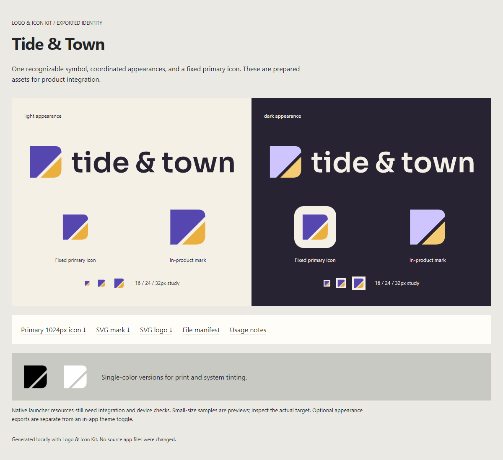

# Logo & Icon Kit

**A reusable Codex skill for going from “show me a few logo ideas” to a clean, organized brand asset pack.**

Explore distinctive concepts, refine a selected mark, coordinate it with a product's themes, and prepare the assets an app actually needs. The workflow combines agent art direction with deterministic local exports.



The example is **Tide & Town**, a sample brand created for this repository. Use your own identity, artwork, and colors.

## What it does

| Stage | Result |
| --- | --- |
| Explore | Different logo ideas, optionally using available image-generation tools |
| Refine | Selected symbol, clean vector geometry, outlined wordmark, light/dark and monochrome versions |
| Export | App icons, favicons, iOS catalog, Android adaptive layers, sharing graphics |
| Inspect | Real files, size/alpha checks, adaptive safe-region measurement, browser gallery |
| Hand off | Organized folder, file manifest, usage notes, and clear integration limits |

**The useful distinction:** a logo inside an app can change color with the theme while the launcher, favicon, store listing, and default sharing identity remain consistent. The skill helps choose that policy rather than silently coupling everything to a theme toggle. Alternate OS appearances are possible when requested.

It does not force a mascot, initial, palette, industry metaphor, or number of concepts. It supports new brands and approved existing marks. It does not build a native app or publish anything as a side effect of exporting assets.

## Install in Codex

Clone the skill into your skills directory. Use `CODEX_HOME/skills` instead when you have configured a different Codex home.

**macOS / Linux**

```sh
git clone https://github.com/MohammedSafwan10/logo-icon-kit.git ~/.codex/skills/logo-icon-kit
cd ~/.codex/skills/logo-icon-kit
npm ci
```

**Windows PowerShell**

```powershell
git clone https://github.com/MohammedSafwan10/logo-icon-kit.git "$env:USERPROFILE\.codex\skills\logo-icon-kit"
Set-Location "$env:USERPROFILE\.codex\skills\logo-icon-kit"
npm ci
```

The skill's entry point is [SKILL.md](SKILL.md). Its automatic discovery metadata is in [agents/openai.yaml](agents/openai.yaml).

## Use it with an agent

```text
Use $logo-icon-kit to create three distinctive logo concepts for my local
discovery app. Use our current light/dark palette, and show each as a logo
and app icon. Don't replace our existing assets until I choose one.
```

```text
Use $logo-icon-kit with this selected logo. Preserve the shape, make a clean
vector master, keep the light icon as the fixed primary identity, and export
favicons, iOS/Android assets, and sharing artwork into a dedicated folder.
```

```text
Use $logo-icon-kit to prepare our existing SVG for app icons and favicons.
No new concepts and no image generation. Export only web and Android assets.
```

Image generation requires an image tool in the host agent environment. The exporter itself needs no API key, paid service, or network calls. It turns supplied vectors into files; it does not invent or trace a production logo automatically.

## Run the exporter directly

Requires **Node 22+**. Install the pinned dependency with `npm ci`.

```sh
npm run example
npm run verify:example
```

Open `output/example/index.html` in a browser. Or supply your own config:

```sh
node scripts/export-kit.mjs --config /path/to/brand.json --out /path/to/new-brand-kit
node scripts/verify-kit.mjs /path/to/new-brand-kit
```

The SVG mark uses simple color tokens such as `fill="{{primary}}"` and `fill="{{secondary}}"`. Config paths resolve relative to the JSON file. Wordmark SVG is optional and must be outlined. The output folder must be new or already owned by this exporter for the same brand; unrelated nonempty folders are refused.

See the working [example config](examples/tide-and-town/brand.json), [SVG mark](examples/tide-and-town/mark.svg), and [export guide](references/exporting.md).

## What's in an exported kit?

```text
brand-kit/
├── source/                   Original SVG templates and outlined wordmark
├── logos/                    Theme and single-color SVGs; transparent PNGs
├── app-icons/
│   ├── primary/              One canonical icon, 192 / 512 / 1024px
│   └── alternates/           Other palette appearances, separately exported
├── web/                      SVG/ICO favicon, 16/32/48px PNGs, touch/maskable icons
├── ios/                      Opaque AppIcon catalog and Icon Composer source layers
├── android/                  Adaptive PNG layers/resources, monochrome, legacy/store art
├── sharing/                  1200×630 cards, 1080px square and avatar
├── index.html                Visual gallery and direct download links
├── USAGE.md                  Identity policy and integration notes
└── manifest.json             Generated file inventory and dimensions
```

Platform folders follow the config's selected targets. With no wordmark, the result is explicitly a symbol-only kit. The exporter writes within its output folder and does not change your app's metadata, source files, launcher settings, or repository.

Native resources still need integration and device checks. Android adaptive foregrounds are density-specific PNGs with portable SVG source layers. iOS Icon Composer source layers are not a compiled `.icon` package. The example web manifest does not enable a PWA. Current platform guidance and handoff details are linked in [platform notes](references/platforms.md).

## Optional wordmark outlining

For simple left-to-right labels, the helper can outline a font you supply:

```sh
python -m pip install fonttools
python scripts/outline-wordmark.py --font /path/to/font.ttf --text "Your Brand" --output /path/to/wordmark.svg
```

This is optional: the normal Node export accepts an already outlined SVG. The helper does not handle complex-script shaping or advanced typography. Respect the font's license. The included example wordmark uses Sora SemiBold; its [font license](examples/tide-and-town/FONT-LICENSE.txt) is included, and no font binary is bundled.

## Validation

```sh
npm test
```

Tests exercise a complete independent-brand export, deterministic reruns, output-folder ownership, and rejection of unsupported source content. The verifier checks generated file presence, PNG dimensions, transparency/opacity, iOS catalog sizes, ICO entries, and Android safe-region bounds.

Visual inspection remains essential. A passing file check does not establish aesthetic quality, trademark uniqueness, native integration, or store approval. The scripts have been exercised on Windows with Node 24 and Sharp 0.35.5; other host environments should run the same example checks.

## Repository map

- [SKILL.md](SKILL.md) — agent workflow and scope.
- [references/concepts.md](references/concepts.md) — concept and recolor prompt guidance.
- [references/exporting.md](references/exporting.md) — input schema, commands, and export semantics.
- [references/platforms.md](references/platforms.md) — platform distinctions and official sources.
- [scripts/](scripts/) — exporter, verifier, and optional wordmark helper.
- [examples/](examples/) — independent sample brand, not a required visual style.

## License

[MIT](LICENSE) for the skill, scripts, and repository example artwork. Third-party font license notices remain applicable to the example wordmark's font source. Your supplied brand assets and fonts retain their own rights and licenses.
